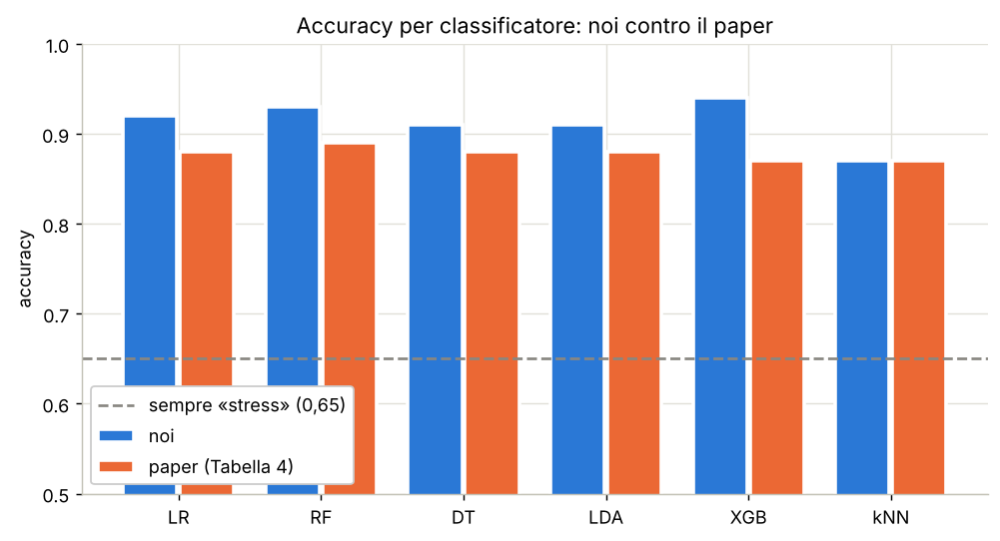

# Riconoscimento dello stress da segnali wearable

Tirocinio · Interfacce uomo-macchina · Università degli Studi dell'Insubria · 2026

**Stato:** in corso — passi 1 e 2 completati

## Il progetto

Partendo dal dataset VitaStress e dal lavoro dei suoi autori, il progetto:
1. riproduce il loro classificatore binario stress / non stress
2. aggiunge feature calcolate dai segnali grezzi del braccialetto (PPG, conduttanza cutanea), che gli autori non usano
3. confronta classificatori classici e una piccola rete neurale (MLP)

Tutti i modelli sono valutati con **leave-one-subject-out**: addestramento su 20 persone, prova sulla 21ª, a rotazione.

## Risultati finora

Replica del classificatore binario degli autori (dati del braccialetto, un campione ogni 30 s):

| modello | accuracy (noi) | accuracy (paper) |
|---|---|---|
| Random Forest | 0,93 ± 0,11 | 0,89 ± 0,11 |
| XGBoost | 0,94 ± 0,10 | 0,87 ± 0,14 |
| Logistic Regression | 0,92 ± 0,13 | 0,88 ± 0,13 |
| kNN | 0,87 ± 0,16 | 0,87 ± 0,13 |

Risultati in linea con il paper; la differenza rientra nella variabilità fra soggetti.



## Dataset

[VitaStress](https://github.com/paulvincenz/VitaStress) — Schreiber et al., ICMI 2025.
21 partecipanti, braccialetto Corsano CardioWatch, quattro condizioni: riposo, stress cognitivo,
stress socio-valutativo (public speaking), sforzo fisico.

I dati **non sono inclusi** in questa repository: i notebook li scaricano automaticamente.
Licenza del dataset: CC BY-NC 4.0.

## Struttura

```
notebooks/
  01_figura4.ipynb                   esplorazione e riproduzione della Figura 4
  02_tabella_classificatore.ipynb    tabella degli autori, classificatori, grafici
docs/
  piano.md                           piano di lavoro
  feature_autori.md                  feature usate dagli autori
  decisions.md                       decisioni prese e motivi
  logbook.md                         diario di lavoro
  guide/                             spiegazione passo per passo di ogni notebook
figures/                             grafici prodotti
```

## Avanzamento

- [x] Esplorazione del dataset
- [x] Riproduzione della Figura 4
- [x] Passo 1 — tabella come gli autori
- [x] Passo 2 — classificatore binario
- [ ] Passo 3 — confronto con il paper (tutti / solo fisiologia / solo movimento)
- [ ] Passo 4 — feature dai segnali grezzi
- [ ] Passo 5 — classificatori con le nuove feature
- [ ] Passo 6 — rete neurale (MLP)
- [ ] Passo 7 — conclusioni e relazione

## Come eseguire

I notebook sono pensati per Google Colab: **Runtime → Esegui tutte**.

## Riferimenti

- Schreiber P., Burbach S., Cinar B., Mackert L., Maleshkova M. *VitaStress: A Multimodal Dataset for Stress Detection.* ICMI 2025.
- Schreiber P., Cinar B., Mackert L., Maleshkova M. *Stress Detection from Multimodal Wearable Sensor Data.* arXiv:2508.10468, 2025.
