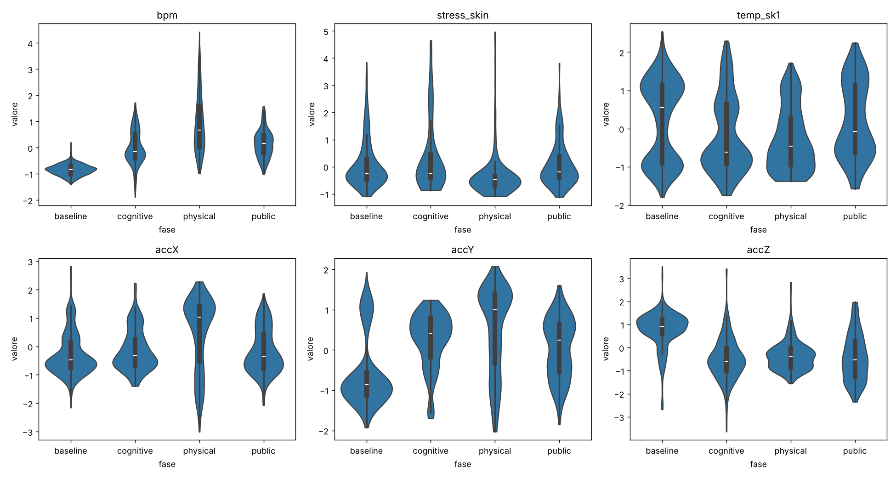
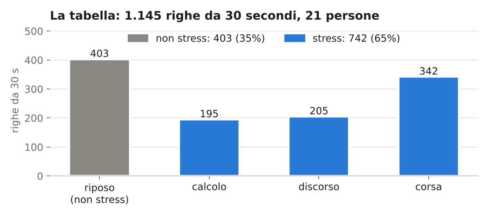
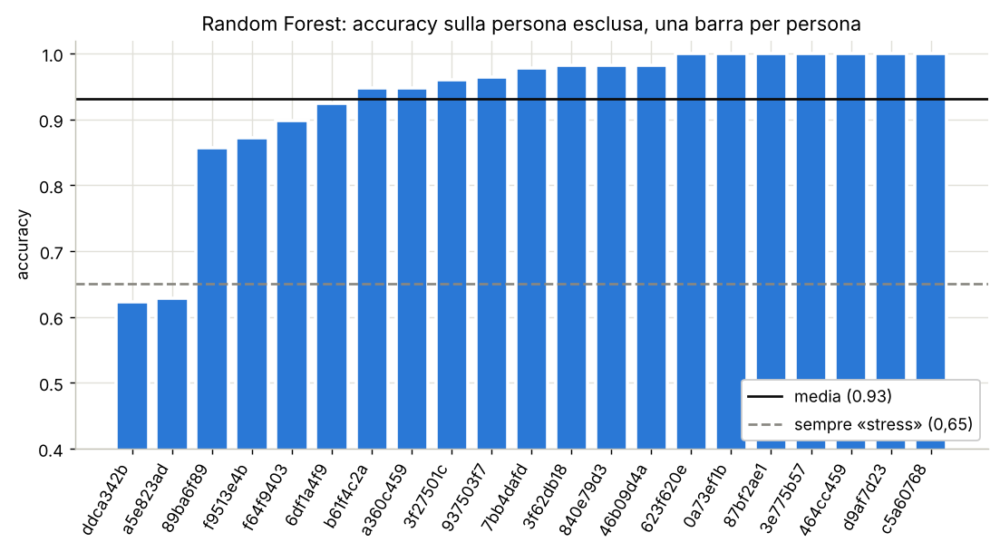
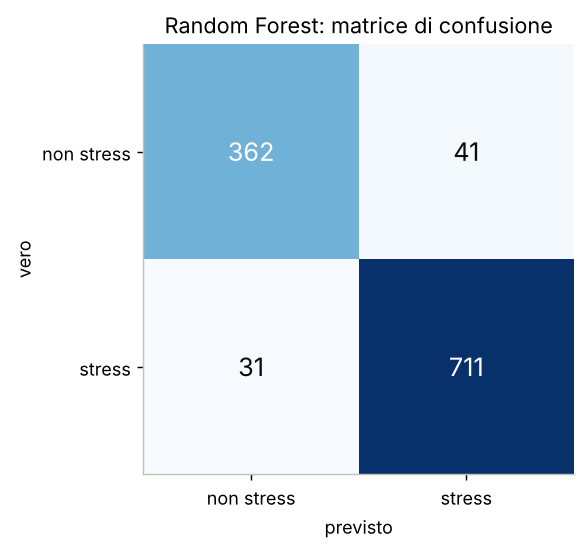
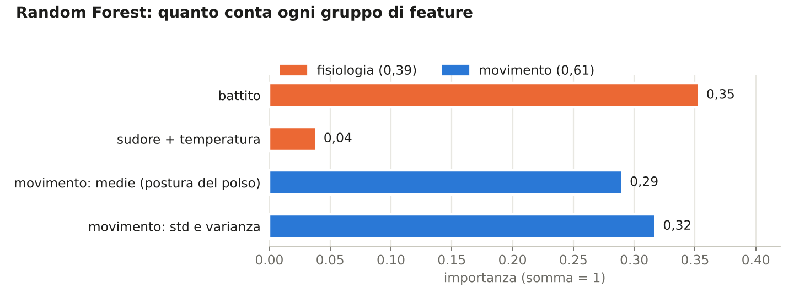
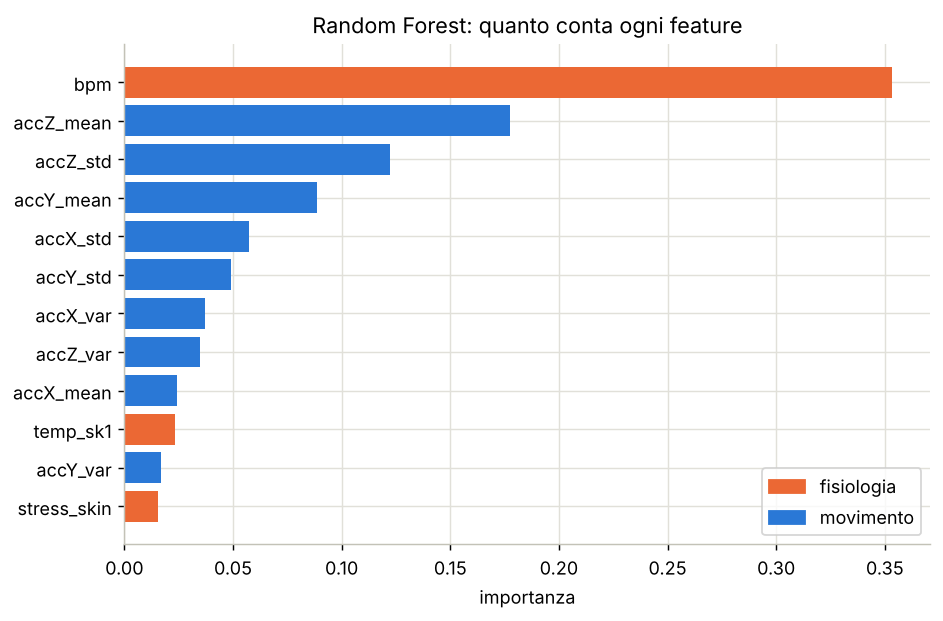
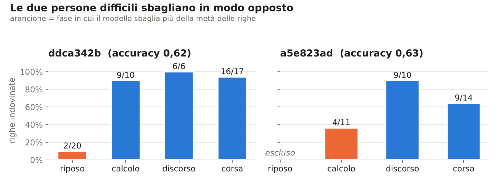
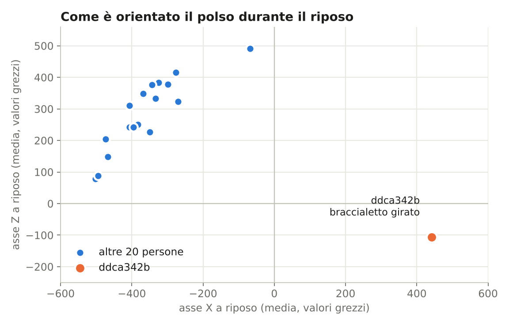
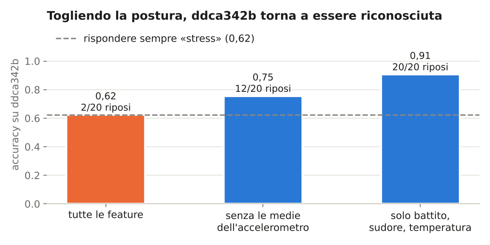

# Riconoscimento dello stress da segnali wearable

Tirocinio · Interfacce uomo-macchina · Università degli Studi dell'Insubria · 2026

**Stato:** in corso. Replica del classificatore degli autori completata (passi 1 e 2); passo 3 in attesa di conferma della prof.

> **In breve**
> - Il classificatore binario degli autori è **replicato**: Random Forest **0,93** contro l'**0,89** del paper.
> - Il modello si appoggia molto al **movimento** (61% dell'importanza), e quasi metà di quel peso viene dalla **postura del polso**.
> - Su una persona con il **braccialetto orientato al contrario** il modello sbaglia quasi tutti i riposi; con la sola fisiologia li riconosce tutti.

---

## Il progetto

Partendo dal dataset VitaStress e dal lavoro dei suoi autori, il progetto:
1. riproduce il loro classificatore binario stress / non stress;
2. aggiunge feature calcolate dai segnali grezzi del braccialetto (PPG, conduttanza cutanea), che gli autori non usano;
3. confronta classificatori classici e una piccola rete neurale (MLP).

**Regola:** prima si rifà il risultato degli autori, poi si cambia una cosa alla volta.
**Validazione, sempre la stessa:** **leave-one-subject-out**, cioè addestramento su 20 persone e prova sulla 21ª, a rotazione. Il modello viene sempre provato su una persona che non ha mai visto.

| passo | cosa | stato |
|---|---|---|
| — | esplorazione del dataset e Figura 4 del paper | ✅ |
| 1 | tabella dei dati come gli autori | ✅ |
| 2 | classificatore binario (sei modelli) | ✅ |
| 3 | confronto fisiologia / movimento | in attesa della prof |
| 4 | feature dai segnali grezzi | da fare |
| 5 | classificatori con le nuove feature | da fare |
| 6 | rete neurale (MLP) | da fare |
| 7 | conclusioni e relazione | da fare |

---

## Dataset

[VitaStress](https://github.com/paulvincenz/VitaStress) — Schreiber et al., ICMI 2025.
21 partecipanti, braccialetto Corsano CardioWatch, quattro condizioni: riposo, stress cognitivo (calcolo mentale),
stress socio-valutativo (discorso in pubblico), sforzo fisico (corsa sul tapis roulant).

I dati **non sono inclusi** in questa repository: i notebook li scaricano automaticamente.
Licenza del dataset: CC BY-NC 4.0.

### Esplorazione: la Figura 4 del paper

Riprodotta su tutti i 21 soggetti, con i valori normalizzati per persona. Coincide con quella del paper per tutte e sei le misure.



- il **battito** sale in tutte le fasi di stress, soprattutto nella corsa;
- l'**accelerometro** cambia molto fra le fasi, anche quando non ci si muove: la media di ogni asse dipende da come è girato il polso;
- `stress_skin`, l'indice di sudore del braccialetto, ha molti zeri (20–45%) e la normalizzazione appiattisce le differenze fra fasi;
- la coda a −8 della temperatura nel paper è un valore a 0 °C, un errore del sensore non rimosso.

---

## Passo 1 — La tabella

Come gli autori: **una riga ogni 30 secondi** per ogni persona, 12 feature.

| segnale | feature | da dove |
|---|---|---|
| battito | `bpm` | valore del braccialetto |
| sudore | `stress_skin` | valore del braccialetto (uno ogni 60 s, ripetuto) |
| temperatura | `temp_sk1` | valore del braccialetto |
| movimento | media, dev. standard e varianza di `accX`, `accY`, `accZ` | calcolate dall'accelerometro grezzo (32 Hz) |

Battito e temperatura a 0 trattati come mancanti, righe incomplete tolte (25 su 1.170), normalizzazione z-score per persona.
Etichetta: riposo = 0, calcolo + discorso + corsa = 1.



Le classi non sono bilanciate: un modello che risponde sempre «stress» ha già il **65% di accuracy**. È questo il livello da battere, non il 50%.

---

## Passo 2 — Il classificatore binario

Sei classificatori, gli stessi del paper, con parametri standard. Validazione leave-one-subject-out.

| modello | accuracy (noi) | accuracy (paper, Tab. 4) | F1 macro (noi) |
|---|---|---|---|
| Logistic Regression | 0,92 ± 0,13 | 0,88 ± 0,13 | 0,90 ± 0,17 |
| **Random Forest** | **0,93 ± 0,11** | **0,89 ± 0,11** | **0,91 ± 0,16** |
| Decision Tree | 0,91 ± 0,09 | 0,88 ± 0,13 | 0,88 ± 0,15 |
| LDA | 0,91 ± 0,14 | 0,88 ± 0,10 | 0,89 ± 0,18 |
| XGBoost | 0,94 ± 0,10 | 0,87 ± 0,14 | 0,91 ± 0,16 |
| kNN | 0,87 ± 0,16 | 0,87 ± 0,13 | 0,84 ± 0,21 |
| *sempre «stress»* | *0,65* | — | *0,39* |


La replica riesce: siamo tra 0 e 7 punti sopra il paper, con deviazioni standard simili. La differenza può dipendere dalla pulizia
dei dati e dagli iperparametri, che il paper non dichiara del tutto. La **F1 macro** (media della F1 delle due classi) conferma
che il modello non si limita a rispondere «stress»: il modello banale scende a 0,39.

### Persona per persona

Con il leave-one-subject-out ogni persona fa una volta da prova: si ottengono 21 accuracy, e lo 0,93 è la loro media.



**19 persone su 21 sono sopra 0,85**; due si fermano a 0,62–0,63 e sono analizzate più sotto.

<table>
<tr>
<td width="42%"></td>
<td>

**Matrice di confusione (Random Forest)**

| | previsto riposo | previsto stress |
|---|---|---|
| **riposo** | 362 | 41 falsi allarmi |
| **stress** | 31 stress mancati | 711 |

Errori: 72 su 1.145. Il riposo viene riconosciuto nel 90% dei casi.

</td>
</tr>
</table>

### Cosa usa il modello per decidere



- la feature più usata è il **battito** (0,35);
- il **movimento** vale nel complesso **0,61** dell'importanza, e quasi metà (0,29) viene dalle **medie dell'accelerometro**, cioè dalla postura del polso;
- **sudore e temperatura** quasi non vengono usati (0,04).

Il sospetto è che il modello riconosca in buona parte **che attività si sta facendo**, più che lo stress. L'importanza è un indizio, non una prova: il passo 3 servirebbe a verificarlo.

<details>
<summary>Importanza feature per feature</summary>



</details>

---

## Le due persone difficili

Le due persone su cui il modello va peggio **sbagliano in modo opposto**, quindi per cause diverse.



### `ddca342b`: il braccialetto è girato

Da fermi l'accelerometro misura soprattutto la gravità, quindi la media degli assi durante il riposo dice **come è orientato il polso**.
Per 20 persone su 21 l'asse X è negativo e l'asse Z positivo; `ddca342b` è l'unica con i segni invertiti.
L'intensità della gravità è normale (462 contro 428–518): il sensore funziona, è solo orientato al contrario (per esempio sull'altro polso).



Dalle altre 20 persone il modello ha imparato che una certa posizione del polso vuol dire «riposo». Il riposo di `ddca342b` ha la
posizione che per gli altri corrisponde allo stress, e il modello si fida della postura più che del battito.

**Verifica** (addestrando sulle altre 20 persone e provando solo su `ddca342b`):



Con tutte le feature il modello non fa meglio di chi risponde sempre «stress». Togliendo la postura migliora, e con la sola
fisiologia riconosce tutti i riposi: i segnali fisiologici di `ddca342b` sono normali, il problema è solo l'orientamento.
Una feature come la **magnitudine del movimento** (passo 4), che non dipende da come è girato il braccialetto, eviterebbe il problema.

### `a5e823ad`: manca il riposo

Il suo riposo dura 82 minuti invece di 10 (probabile errore nelle annotazioni) ed è stato escluso. Senza riposo, la normalizzazione
per persona è calcolata solo sulle fasi di stress: circa metà delle righe di stress finisce «sotto la media» e il modello le scambia
per riposo. Su questa persona rispondere sempre «stress» darebbe 1,00, quindi il suo risultato non è confrontabile con gli altri.

---

## Domande aperte per la prof

- rifare il confronto **solo fisiologia / solo movimento** (righe Physio e Motion della Tabella 4 del paper)?
- provare un compito **senza la corsa** (riposo contro calcolo + discorso), per separare lo stress dal movimento?
- quali **feature nuove** calcolare e in che ordine; finestre da **60 secondi**?
- **normalizzazione per persona**: dichiararla come limite o provare una variante con il solo riposo (calibrazione)?
- `ddca342b` e `a5e823ad`: tenerle o escluderle?

## Prossimi passi

**Passo 4 — Feature dai segnali grezzi**, un segnale alla volta:

| segnale grezzo | feature | perché |
|---|---|---|
| `bioz` (25 Hz) | numero e ampiezza delle reazioni di sudore, livello di fondo | `stress_skin` del braccialetto è pieno di zeri |
| PPG (62,5 Hz) | variabilità del battito: SDNN, RMSSD, pNN50 | il braccialetto perde gli intervalli fra battiti durante lo stress (mancanti 68–99,8%) |
| `acc` (32 Hz) | magnitudine del movimento | non dipende dall'orientamento del polso |
| temperatura (1 Hz) | media, deviazione standard, pendenza | andamento più fine di `temp_sk1` |

Poi **passo 5** (stessi classificatori con le nuove feature), **passo 6** (MLP) e **passo 7** (conclusioni). Fine del lavoro sperimentale: 19 dicembre 2026.

---

## Struttura

```
notebooks/
  01_figura4.ipynb                   esplorazione e riproduzione della Figura 4
  02_tabella_classificatore.ipynb    tabella degli autori, classificatori, grafici,
                                     analisi delle due persone difficili
docs/
  piano.md                           piano di lavoro
  feature_autori.md                  feature usate dagli autori
  decisions.md                       decisioni prese e motivi
  logbook.md                         diario di lavoro
  guide/                             spiegazione passo per passo di ogni notebook
                                     e aggiornamento per la prof
figures/                             grafici prodotti
```

## Come eseguire

I notebook sono pensati per Google Colab: **Runtime → Esegui tutte**.

## Riferimenti

- Schreiber P., Burbach S., Cinar B., Mackert L., Maleshkova M. *VitaStress: A Multimodal Dataset for Stress Detection.* ICMI 2025.
- Schreiber P., Cinar B., Mackert L., Maleshkova M. *Stress Detection from Multimodal Wearable Sensor Data.* arXiv:2508.10468, 2025.
